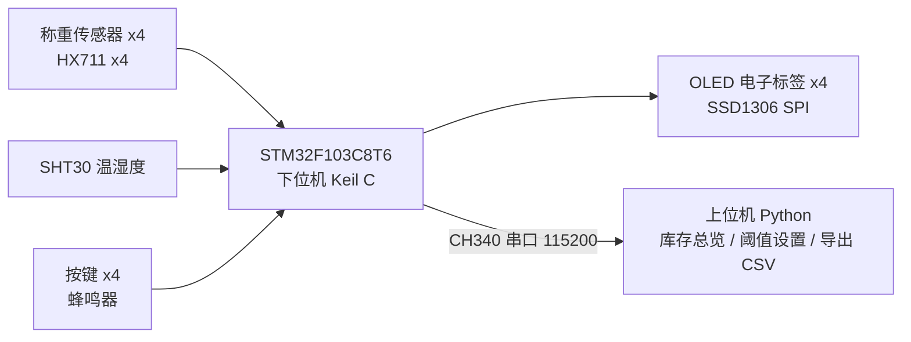

# 基于 STM32 的智能中药存储管理系统设计与实现

医院中药房饮片储存柜，只做中药区，落地为 4 格桌面样机柜。

- 学校：湛江科技学院，计算机工程学院，23 级物联网工程 2 班
- 学生：朱锦霖
- 指导教师：卢振坡

## 这个项目解决什么问题

中药房饮片靠人工称重、人工记数，容易出现这几个问题：取药后余量不清、缺药发现不及时、柜内温湿度超了没人知道。

本项目每格装 1 只称重传感器 + 1 块 OLED 电子标签，柜内装 1 只温湿度传感器：

- 取药 / 补药后，重量变化直接反映在库存里，低于阈值就报警
- 每格 OLED 显示本格余量，不用翻账本
- 温湿度超限就报警，阈值可以在上位机改
- 上位机汇总 4 格库存，能查取补记录、能导出 CSV 给论文用

不做 RFID / 扫码 / 联网 / 图像识别，功能核心优先。

## 当前进度

- [x] 开题报告：已按学校官方模板提交（2026-10-30 前）
- [x] 仓库结构 + 下位机 / 上位机初始框架
- [ ] 硬件采购：方案已比价（淘宝 11 件 ¥73.08 + 拼多多 5V2A 电源 ¥9.8，合计 ¥82.88），尚未决定购买
- [ ] 硬件到货：先验证 1 格，再批量到 4 格
- [ ] 下位机联调：点灯 → 称重 → OLED → SHT30 → 蜂鸣器 → 上位机，逐块调通
- [ ] 称重标定：标准砝码多点标定，精度以实测为准
- [ ] 论文初稿：目标 2027-01-08 前（初稿 Word 已生成，尚未传到本仓库）

> 状态口径：上面打勾的才是已完成，没打勾的不要当成已完成。称重精度、传感器量程以实测为准。

## 系统结构



工作流程：上电初始化 → 周期采集 → 滤波标定 → 阈值判断 → 联动决策 → 显示上传 → 下一轮

## 技术方案（已定）

| 部分 | 选型 |
|---|---|
| 主控 | STM32F103C8T6 |
| 下位机 | C 语言，Keil MDK |
| 上位机 | Python，VS Code，CH340 串口 |
| 称重 | 每格 1 只称重传感器 + 1 片 HX711，两线串行时序，不是标准 SPI |
| 电子标签 | 每格 1 块 0.96 寸 OLED，SPI 7 针版 SSD1306，4 块共用 SPI 总线、独立片选 |
| 温湿度 | SHT30（I2C），默认温度上限 30℃、湿度上限 75%，阈值可调 |
| 交互 | 独立按键（选格 / 确认去皮 / 阈值加减）+ 有源蜂鸣器报警 |
| 通信 | CH340 串口，115200 |

## 目录结构

```
firmware/               下位机：STM32 C 代码（Keil MDK）
  inc/config.h          格数、阈值默认值、引脚口径
  inc/hx711.h           称重接口
  inc/oled.h            OLED 电子标签接口
  inc/sht30.h           温湿度接口
  inc/key.h             按键接口
  inc/buzzer.h          蜂鸣器接口
  inc/protocol.h        串口协议
  src/main.c            主循环
  src/hx711.c           8 次滑动平均滤波已实现；读原始值待填
  src/oled.c            骨架，待填 SSD1306 驱动
  src/sht30.c           骨架，待填 I2C 读取
  src/key.c             骨架，待填按键扫描 + 消抖
  src/buzzer.c          骨架，待填 PC13 输出
  src/protocol.c        文本行协议已实现
host/                   上位机：Python 串口程序（VS Code）
  main.py               读串口、更新库存表、Ctrl+C 时导出 CSV
  protocol.py           串口协议解析 / 组包
  inventory.py          库存表、缺药判断、导出 CSV
  requirements.txt      pyserial
hardware/               硬件：引脚分配、采购清单、接线说明
docs/                   文档：开题、初稿、交接文档等
```

各目录的详细说明见 `firmware/README.md`、`host/README.md`、`hardware/README.md`。

## 快速上手

### 上位机

```bash
pip install -r host/requirements.txt
python host/main.py --port COM3 --baud 115200   # Windows，端口按设备管理器里的改
python host/main.py --port /dev/ttyUSB0 --baud 115200  # Linux
```

按 Ctrl+C 退出，退出时自动导出 `records.csv`。

> 上位机 Python 语法已检查通过，串口部分要等硬件到货才能实测。

### 下位机

初始框架已写，尚未联调、尚未编译验证。这里没有 CubeMX 生成的初始化代码，也没有 Keil 工程文件（`.uvprojx`），用 Keil 建工程时再补，不要把本目录当成能直接编译的完整工程。

调试顺序（到货后逐块来，每调通一块再接下一块）：点灯 → 称重 → OLED → SHT30 → 蜂鸣器 → 上位机。

## 串口协议

纯文本行，方便用串口助手直接看，也方便上位机解析。

| 方向 | 格式 | 例子 |
|---|---|---|
| 上行 | `DATA,<格号>,<重量克>,<温度>,<湿度>` | `DATA,1,123.4,25.1,60.2` |
| 下行 | `SET,TH,<温度上限>,<湿度上限>` | `SET,TH,30,75` |
| 下行 | `TARE,<格号>` | `TARE,1` |

## 测试计划（论文要用）

- 标准砝码多点标定：静态误差、重复性（设计目标 ±1g 以内，以实测为准）
- 温湿度与标准温湿度计对比
- 功能场景：正常取药、缺药报警、温湿度超限、断电重启配置保留
- 测试方法分工：砝码做标定和精度测试；茶叶 / 干货 / 沙子分装小袋模拟饮片做功能演示

## 待定事项（不要擅自当成定论）

- 称重传感器量程：1kg 还是 5kg，第一批两种各买一只对比后再定
- 称重精度指标：以实测为准
- 是否单独加一块主屏：可先不上，用上位机代替

## 关键时间节点

- 开题报告提交：2026-10-30 前（已完成）
- 论文初稿：2027-01-08 前
- 中期检查：2027-03-01 前
- 定稿查重（<30%）与 AIGC 检测（<30%）：2027-03-19 前
- 答辩：2027-04-24—27
- 终稿提交：2027-05-11 前；材料归档：2027-05-30 前
